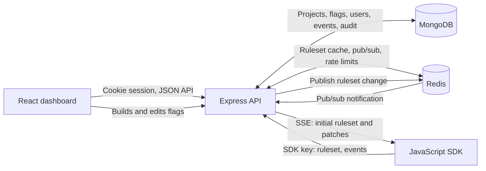

# FlagKit

FlagKit is a self-hosted feature flag service with a browser dashboard, an HTTP API, and a JavaScript SDK. It evaluates flags locally in the SDK using rulesets served by the API.

## What it does

- Manages feature flags with per-environment targeting rules and percentage rollouts.
- Records experiment exposures and conversions and provides conversion statistics by variation.
- Sends live ruleset updates to connected SDK clients over Server-Sent Events (SSE).
- Provides a JavaScript SDK.
- Records project changes in an audit log.
- Applies project roles: viewers read, editors make most flag and environment changes, and admins manage SDK keys and delete flags.

## Architecture



**Dashboard.** The React application uses the API for projects, environments, flags, audit entries, experiment results, and SDK keys. During development, Vite proxies `/api` and `/sdk` to the API server.

**API.** The Express server provides the cookie-authenticated dashboard API and the SDK API. It checks project membership and role for project resources, validates requests, stores persistent data in MongoDB, and uses Redis for ruleset caching, update notifications, and rate-limit counters.

**SDK.** The JavaScript SDK downloads an environment ruleset, evaluates flags locally, and can keep its rules current with SSE or polling. It submits experiment exposure and conversion events to the SDK API.

**MongoDB and Redis.** MongoDB is the source of truth for users, projects, environments, flags, audit entries, SDK keys, and events. Redis holds generated rulesets, distributes update notifications, and stores rate-limit state.

## How a flag change reaches an SDK

1. An editor saves an environment's flag configuration through the dashboard API. The write includes the version the editor loaded; the API and MongoDB compare that version before replacing the stored configuration, returning a conflict if another edit won the race.
2. After saving, the API increments the environment ruleset version, rebuilds the ruleset from MongoDB, and writes it to Redis with a compare-and-set script. The script refuses to replace a cached ruleset whose version is equal to or newer than the incoming version, so a slower, older rebuild cannot overwrite a newer ruleset.
3. When the cache write succeeds, the API publishes a change notification through Redis pub/sub. The API's stream hub sends the update to SDK clients connected to that environment; a new SSE connection receives a full ruleset first, then patches.
4. The SDK applies newer consecutive patches and ignores patches at or below its current version. If a patch skips one or more versions, the SDK fetches the full ruleset instead of applying a potentially incomplete sequence.
5. If Redis cannot complete a ruleset sync, the API reports the saved change as delayed. A later cache miss can rebuild the ruleset from MongoDB.

## Quick start

### Prerequisites

- Node.js 20 or newer and npm.
- Docker Compose to run the repository's MongoDB and Redis services, or reachable MongoDB and Redis instances.

### Install and configure

```sh
npm install
```

Run the command from the checked-out repository root.

Copy `.env.example` to `.env`. Replace the placeholders with local values; do not use the placeholders as production credentials. `MONGODB_URI`, `REDIS_URL`, and `JWT_SECRET` are required by the API. The secret must be at least 32 characters and must not be a placeholder.

| Name | Purpose | Default or example |
| --- | --- | --- |
| `NODE_ENV` | Runtime mode | `development` |
| `PORT` | API listen port | `3000` |
| `MONGO_ROOT_USERNAME` | MongoDB root user for Compose | Set a local value |
| `MONGO_ROOT_PASSWORD` | MongoDB root password for Compose | Set a strong local value |
| `MONGO_DB` | MongoDB initialization database for Compose | `flagkit` in the example |
| `MONGO_PORT` | Published MongoDB port | `27017` |
| `REDIS_PASSWORD` | Redis password for Compose | Set a strong local value |
| `REDIS_PORT` | Published Redis port | `6379` |
| `MONGODB_URI` | API's MongoDB connection string | Required; provide a URI with placeholders replaced |
| `REDIS_URL` | API's Redis connection string | Required; provide a URI with placeholders replaced |
| `JWT_SECRET` | Session-token signing secret | Required; use a private value of at least 32 characters |
| `SEED_USER_EMAIL` | Email for the seed account | Required by seeding; set a local address |
| `SEED_USER_PASSWORD` | Password for the seed account | Required by seeding; at least 12 characters |
| `SEED_USER_NAME` | Display name for the seed account | Required by seeding |

The rate-limit variables in `.env.example` are optional; their defaults are listed under [Configuration reference](#configuration-reference).

### Start data services and seed demo data

Start the bundled MongoDB and Redis services:

```sh
npm run docker:up
```

The Compose services read their credentials and host ports from `.env`. If using hosted services instead, set `MONGODB_URI` and `REDIS_URL` to connection strings reachable by the API.

With the seed account settings configured, run:

```sh
npm run seed
```

The seed command refuses to run when `NODE_ENV=production`. It creates or replaces the demo project with sample flags, environments, and SDK keys; it prints the generated SDK keys once. Do not run it against data you need to preserve.

### Run the API and dashboard

In one terminal, start the API:

```sh
npm run dev -w @flagkit/server
```

In another terminal, start the dashboard:

```sh
npm run dev -w @flagkit/client
```

Open the dashboard at the Vite URL shown in the terminal (the configured development port is `5173`). Sign in with the seed email and password. For the dashboard's SDK Demo page, copy `client/.env.example` to `client/.env.local` and set `VITE_DEMO_CLIENT_SDK_KEY` to a client SDK key from the seed output. `VITE_API_URL` is optional; when unset, the dashboard uses its current origin and the Vite `/sdk` proxy.

Run every workspace's tests from the repository root:

```sh
npm test
```

### SDK usage

Install the workspaces from the repository root and import `flagkit-sdk`. Keep a server SDK key in trusted server-side configuration; browser applications must use a client SDK key, which is public and can read the environment's targeting rules.

```js
import { createClient } from 'flagkit-sdk';

const client = createClient({
  sdkKey: process.env.FLAGKIT_SDK_KEY,
  baseUrl: process.env.FLAGKIT_URL,
});

await client.waitForInit();

const user = { key: 'example-user', plan: 'pro' };
const enabled = client.variation('checkout', user, false);

client.track('signup_completed', user);
await client.close();
```

## Configuration reference

All listed settings are validated by `server/src/env.js`. Numeric values have the ranges shown; values outside them prevent the server from starting.

### Rate limits and login backoff

Rate limits use Redis-backed fixed windows. A Redis Lua script atomically increments each counter with `INCR` and sets its expiry with `PEXPIRE`; it is not a token bucket or sliding window. The API has public-IP, authentication-IP, authentication-email, dashboard-user, SDK-IP, and SDK-key tiers.

| Variable | Default | Allowed range |
| --- | ---: | ---: |
| `PUBLIC_RATE_LIMIT_IP_MAX` | 120 | 1–1,000,000 |
| `PUBLIC_RATE_LIMIT_IP_WINDOW_SECONDS` | 60 | 1–3,600 |
| `AUTH_RATE_LIMIT_IP_MAX` | 30 | 1–10,000 |
| `AUTH_RATE_LIMIT_IP_WINDOW_SECONDS` | 60 | 1–3,600 |
| `AUTH_RATE_LIMIT_EMAIL_MAX` | 20 | 1–10,000 |
| `AUTH_RATE_LIMIT_EMAIL_WINDOW_SECONDS` | 60 | 1–3,600 |
| `DASHBOARD_RATE_LIMIT_USER_MAX` | 600 | 1–1,000,000 |
| `DASHBOARD_RATE_LIMIT_USER_WINDOW_SECONDS` | 60 | 1–3,600 |
| `SDK_RATE_LIMIT_KEY_MAX` | 6,000 | 1–10,000,000 |
| `SDK_RATE_LIMIT_KEY_WINDOW_SECONDS` | 60 | 1–3,600 |
| `SDK_RATE_LIMIT_IP_MAX` | 12,000 | 1–10,000,000 |
| `SDK_RATE_LIMIT_IP_WINDOW_SECONDS` | 60 | 1–3,600 |
| `AUTH_BACKOFF_BASE_MS` | 500 | 1–600,000 |
| `AUTH_BACKOFF_CAP_MS` | 30,000 | 1–3,600,000 |
| `AUTH_BACKOFF_QUIET_SECONDS` | 900 | 1–86,400 |

`TRUST_PROXY` defaults to `0` and accepts `0`–`10`. It controls Express proxy trust and therefore which address is used for `req.ip`; configure it to match the actual trusted proxy hops in front of the API.

### Request and resource limits

| Variable | Default | Allowed range |
| --- | ---: | ---: |
| `JSON_BODY_LIMIT` | `100kb` | String matching a number followed by `kb` or `mb` |
| `MAX_PROJECTS_PER_USER` | 20 | 1–1,000 |
| `MAX_SDK_KEYS_PER_ENV` | 25 | 1–200 |
| `MAX_FLAGS_PER_PROJECT` | 500 | 1–10,000 |
| `MAX_VARIATIONS` | 10 | 2–50 |
| `MAX_RULES_PER_ENV` | 50 | 1–500 |
| `MAX_CONDITIONS_PER_RULE` | 10 | 1–50 |
| `MAX_VALUES_PER_CONDITION` | 100 | 1–1,000 |
| `MAX_USER_CONTEXT_BYTES` | 4,096 | 256–65,536 |
| `MAX_EVENTS_PER_BATCH` | 100 | 1–1,000 |
| `SDK_EVENTS_MAX_BYTES` | 65,536 | 256–1,048,576 |
| `MAX_SSE_CONNECTIONS_PER_KEY` | 100 | 1–10,000 |
| `SSE_HEARTBEAT_SECONDS` | 25 | 1–300 |

Other server defaults include `JWT_TTL_SECONDS=28800` (60–2,592,000), `BCRYPT_COST=12` (4–15), and `RULESET_CACHE_TTL_SECONDS=3600` (60–604,800). `CORS_ORIGINS` defaults to the local Vite development origin and accepts comma-separated HTTP(S) origins without paths or wildcards.

## Docker

Build the API image from the repository root:

```sh
docker build -t flagkit-api .
```

Run it with runtime configuration from an environment file:

```sh
docker run --rm -p 3000:3000 --env-file .env flagkit-api
```

The MongoDB and Redis URLs in that environment file must resolve from inside the container. The image sets `NODE_ENV=production`, runs as the non-root `node` user, and does not include `.env`; supply secrets and connection strings at run time. Its Docker `HEALTHCHECK` requests the container's `/healthz` endpoint and treats a successful HTTP response as healthy; that endpoint does not check MongoDB or Redis connectivity.

## Benchmarks

The results below are the medians of three successful local live benchmark runs. Each run used 50 concurrent connections and ran each scenario for 15 seconds.

| Scenario | Requests per second | p50 latency (ms) | p97.5 latency (ms) | p99 latency (ms) |
| --- | ---: | ---: | ---: | ---: |
| Full ruleset response (HTTP 200) | 1,497 | 31 | 51 | 60 |
| Conditional not-modified response (HTTP 304) | 1,644 | 29 | 39 | 43 |

**Ruleset size:** 5 flags; the JSON response measured 1,853 bytes during verification against the local Acme Production environment.

**Test environment:** Node.js v22.22.3, Docker 29.9.2, local API container, local Docker MongoDB and Redis. The benchmark process ran on the host and targeted `http://localhost:3002`. Both `SDK_RATE_LIMIT_KEY_MAX` and `SDK_RATE_LIMIT_IP_MAX` were set to `1,000,000` for the benchmark container.

Each run passed both scenarios. Full ruleset requests returned HTTP 200, and conditional requests returned HTTP 304. All six scenario-runs reported zero unexpected responses and zero request errors.

These results describe this local test environment, not guaranteed production capacity. Performance depends on the machine, workload, ruleset size, and system load. The `BENCH_MODE=inprocess` mode uses in-memory test stores and fake Redis, so it measures framework overhead rather than deployed-service performance.

## Security notes

- Dashboard session cookies are `httpOnly`, `SameSite=Lax`, and `Secure` in production.
- `POST`, `PUT`, and `DELETE` `/api` requests require `X-Requested-By: flagkit-dashboard`; `GET`, `HEAD`, and `OPTIONS` are exempt.
- SDK keys are stored as SHA-256 hashes with a short prefix; clients send keys in the `Authorization` header.
- Request schemas reject unknown fields and validate request bodies, query parameters, and path parameters.
- Redis-backed rate limits are applied to the API and SDK tiers; limiter errors are logged without connection strings and fail open when Redis is unavailable.
- Serialized errors redact connection strings and common credential-shaped values; reviewed infrastructure error paths use this serializer.

See [SECURITY_REVIEW.md](./SECURITY_REVIEW.md) for the repository security review and its documented findings and verification limits.

## Design decisions and tradeoffs

### MongoDB source of truth, Redis cache

MongoDB stores the persistent configuration and event data, while Redis stores generated rulesets, carries update notifications, and tracks rate limits. SDK ruleset requests can be served from Redis while the cache is available, but Redis outages can delay live synchronization and disable rate limiting until Redis recovers.

### Deterministic hashing for rollouts

The evaluator hashes the flag key, environment salt, and user key with MurmurHash3 and maps the result to a stable rollout bucket. The same inputs therefore receive the same bucket; changing the flag, environment, or user key can change the assignment.

### Client SDK keys are public

Client keys are designed for browser use and are not secrets. They can read the environment's full targeting rules, so do not put secrets or sensitive values in flag rules or variation values.

### Fixed-window rate limiting

Rate limits count requests in Redis-backed fixed windows, not token buckets or sliding windows. The Redis Lua script uses `INCR` and expiry to count requests within each window. This is simple to operate, but requests clustered around a window boundary can exceed the configured maximum across the two adjacent windows.

### Fail open when Redis is down

Rate-limit middleware logs a warning and permits the request when Redis operations fail; ruleset sync can likewise report a saved change as delayed. This favors API availability, but rate limits and immediate propagation are not guaranteed during a Redis outage.

### Per-flag optimistic locking

Environment configuration saves compare the version the editor loaded with the stored version and return a conflict instead of silently overwriting a concurrent edit. This prevents lost updates but requires the editor to reload and retry after a conflict.

### SSE instead of WebSockets

The server uses SSE for server-to-SDK ruleset updates, while SDK requests and events use ordinary HTTP. SSE fits the one-way update flow; the SDK falls back to polling after repeated stream failures.

## Known limitations

- Registration is open: the server has no `REGISTRATION_ENABLED` setting. The auth routes do not provide password reset or email verification.
- The per-email auth rate limit applies to login and registration across IPs. An attacker can consume a victim's email-tier allowance and temporarily throttle those requests.
- Anyone holding a client SDK key can submit fabricated, valid-shaped exposure and conversion events for arbitrary user keys. Accepted events can affect experiment results; client telemetry is not proof of user activity.
- Client SDK keys expose the complete targeting rules for their environment; rule values must not contain secrets.
- Logout clears the browser cookie but does not revoke a copied JWT. A copied token remains valid until it expires (eight hours by default; configurable up to 30 days).
- The security review reports dependency advisories affecting development dependencies only (10 vulnerable package entries at review time); no dependency updates were applied.
- The seed command prints generated SDK keys to stdout. Captured terminal or CI output could retain them; seed only where that output is access-controlled and not retained.
- `HEAD` and `OPTIONS` are exempt from the `/api` custom-header check, in addition to `GET`. An incorrect `TRUST_PROXY` hop count can also allow forwarded client IP spoofing and weaken IP-based limits.
- Experiment statistics are calculated from SDK-submitted exposure and conversion events. The API compares each non-control variation with the first variation as the control and uses a two-proportion z-test; results depend on the submitted event data and sample size.
- Benchmark results are from a three-run local test and do not establish production capacity. Results can vary with workload, ruleset size, infrastructure, and system load.

## Repository layout

```text
client/               React dashboard
packages/evaluator/   Shared flag targeting and rollout evaluator
sdk/                  JavaScript SDK
server/               Express API, persistence, and server tests
```

## Screenshots

Add real screenshots of the running dashboard here.
